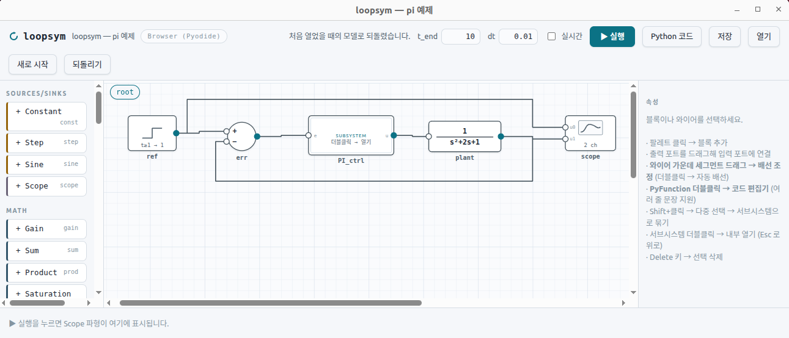
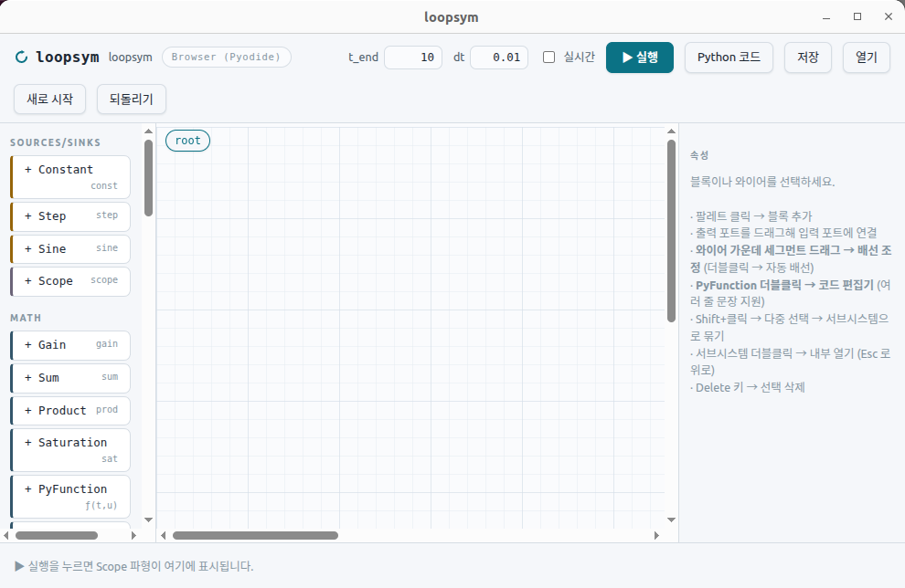

# Loopsym — visual block-diagram simulation for control systems and robotics, by Sentiery

교육용 파이썬 블록 다이어그램 시뮬레이터. Simulink 의 핵심 원리(블록·와이어·
실행 순서·solver)를 파이썬으로 직접 만들어 보는 수업용 엔진이자, 시뮬레이션
에서 실기체(ROS2/HILS)까지 같은 다이어그램으로 가는 드론/로봇 개발 플랫폼.
전체가 순수 파이썬이라 학생이 한 학기에 바닥부터 따라 만들 수 있는 규모다.

License: Apache-2.0 · Copyright 2026 Sentiery ·
[Repository](https://github.com/sentiery-labs/loopsym) ·
[Issues](https://github.com/sentiery-labs/loopsym/issues)

> 뷰어는 **데스크톱 전용**입니다 (최소 폭 1024px 권장). 모바일/태블릿
> 레이아웃은 아직 지원하지 않습니다.

## 빠른 시작 (PyPI — 3단계)

```bash
python -m pip install loopsym
loopsym            # PI 폐루프 데모가 로드된 뷰어가 앱 창으로 열린다
                   # → ▶ 실행 → 아래 Scope 에 ref/y 두 채널 표시
```



- **첫 실행은 인터넷이 필요합니다** — 브라우저가 Pyodide(파이썬 런타임)를
  CDN 에서 내려받습니다 (수 초, 이후 캐시). 오프라인이면 상태줄 안내대로
  `python -m loopsym.server` 를 켜고 새로고침하면 됩니다 (`[server]` extra 필요).
- 다른 시작점: `loopsym --blank` (빈 캔버스), `loopsym --example pendulum`
  (번들 예제: pi·pendulum·discrete_pi), `loopsym my_model.json` (저장한 모델).
  `loopsym --help` 가 전체 형태를 설명합니다.



파이썬 코드로 직접 만들 수도 있습니다 (설치만으로 동작, 의존성 0):

```python
from loopsym import *
import webbrowser

bd = Diagram()
ref   = bd.add(Step(t_on=1.0))
err   = bd.add(Sum("+-"))
plant = bd.add(TransferFunction([1], [1, 2, 1]))
ctrl  = bd.add(PyFunction("3.0*u0", n_in=1))     # <- MATLAB Function 블록처럼
scope = bd.add(Scope(n_in=2))

bd.connect(ref, err[0]); bd.connect(plant, err[1])
bd.connect(err, ctrl);   bd.connect(ctrl, plant)
bd.connect(ref, scope[0]); bd.connect(plant, scope[1])

run(bd, t_end=10.0, dt=0.01)
path = render_html(bd, "diagram.html")   # 브라우저에서 구조 확인/편집/재실행
print("뷰어:", path)
webbrowser.open("file://" + path)
```

## 소스에서 개발

```bash
git clone https://github.com/sentiery-labs/loopsym && cd loopsym
python -m pip install -e ".[examples]"     # matplotlib (ex1~ex4 의 PNG 플롯용)
python examples/ex1_pi_closed_loop.py      # ex1_result.png + ex1_diagram.html 생성
```

예제 카탈로그(난이도/의존성/생성물)는 `examples/README.md` 참조.
전체 개발 환경: `pip install -e ".[dev]"` + `npm install` 후
`python -m pytest tests/ -q` (node+pyodide 있으면 뷰어 스모크 포함).

## 구성

| 파일 | 내용 | 수업 주제 |
|------|------|-----------|
| `loopsym/core.py` | `Block` 베이스 클래스, `Diagram`, 위상 정렬 + 대수 루프 검출 | 클래스/상속, 그래프 알고리즘 |
| `loopsym/blocks.py` | Step·Gain·Sum·Product·Integrator·TransferFunction·**PyFunction**·Scope + **Subsystem**(Inport/Outport, **마스크**) + **이산 블록**(UnitDelay·DiscreteIntegrator·DiscreteTF·ZeroOrderHold) + Mux/Demux | 상태공간, feedthrough, 샘플링 |
| `loopsym/sim.py` | **flatten**(서브시스템 펼치기) + 고정 스텝 RK4 + 이산 상태 실행 | 수치적분, 안정성, 계층 구조 |
| `loopsym/viz.py` + `viewer.html` | 인터랙티브 뷰어 + `save_json`/`load_json` | — |
| `loopsym/realtime.py` | **실시간 모드**: `run_realtime()` — 절대 데드라인 + hybrid sleep 페이서, 지터 계측 | 실시간 시스템, 스케줄링 |
| `examples/ex5_realtime_demo.py` | P40 데모(이산 PI 50Hz)를 뷰어에서 라이브로 | 실시간 vs 배치 |
| `loopsym/ros2.py` | **ROS2 블록**: `Ros2Subscribe`/`Ros2Publish` — 다이어그램이 곧 rclpy 노드 | 미들웨어, ZOH/지연 |
| `examples/ex6_ros2_turtlesim.py` | turtlesim go-to-goal — 블록 제어기가 실제 ROS2 토픽 폐루프 | 실기체로 가는 다리 |
| `examples/ex1_pi_closed_loop.py` | PI 제어 폐루프 (2차 플랜트) | 폐루프, 정상상태 오차 0 |
| `examples/ex2_pendulum_pyfunction.py` | 비선형 진자 + PD (PyFunction) | 왜 적분항이 필요한가 |
| `examples/ex3_subsystem.py` | 마스크 PI 서브시스템 (`Gain(k="$Kp")`) | 계층화, flatten, 마스크 |
| `examples/ex4_discrete_pi.py` | 연속 PI vs 이산 PI (Ts 영향) | 샘플링, PX4 로 가는 다리 |
| `tests/` | pytest 회귀 + **Pyodide 스모크**(뷰어 실행 경로 검증) | — |
| `docs/` | 15주 커리큘럼 설계, P14/P40 스파이크 결과 | — |
| `benchmarks/` | **실시간 지터 재검증** (`p40_realtime.py --hz --duration`) + 결과 리포트 | — |
| `spikes/`, `hardware/` | 최초 실시간 스파이크(폐기됨 — benchmarks 가 유효), Bebop 2 스파이크(+안전 체크리스트) | — |

엔진 확장 모듈 (전부 순수 파이썬, PX4 v1.16 검증본 이식):

| 파일 | 내용 |
|------|------|
| `loopsym/drone.py` | 6-DoF 멀티로터 플랜트(프레임: quad X/+, hexa, octo) + PX4 Rate/Attitude/Position Controller + Mixer + 화이트박스 조립 블록 |
| `loopsym/sensors.py` | IMU, Rangefinder — fidelity 규약(ideal/noisy/world, 포트 불변, 시드 고정) |
| `loopsym/world.py` + `world_protocol.py` | **3D 월드 연동**: WorldLink, Camera, Image — SENTIERY 3D 월드와 lockstep |
| `loopsym/estimation.py` | ComplementaryFilter (Mahony) |
| `loopsym/navigation.py` | WaypointManager (웨이포인트 순회) |
| `loopsym/joystick.py` | 게임패드 입력 (브라우저 Gamepad API → 서버, RC Mode 2) |
| `examples/ex7~ex10` | 드론 위치제어 / IMU fidelity / PX4 화이트박스 / 조이스틱 비행 — `examples/README.md` |

## 다이어그램 뷰어 (`render_html`)

- Simulink 식 도형: Gain ▷ 삼각형(값 내부 표시), Sum ○ 원(부호 표시),
  Product ×/÷, Integrator `1/s`, TransferFunction 분수 표기, Scope 파형 아이콘
- 블록 드래그, 출력→입력 포트 드래그로 와이어 연결/재연결, Delete 로 삭제
- **Simulink 식 직교 배선**: 자동 배선이 다른 블록을 피해 가고, 와이어
  가운데 세그먼트를 드래그하면 수동 배선(저장/열기 보존). 더블클릭 = 자동 복귀
- **Shift+클릭 다중 선택 → "서브시스템으로 묶기"** (경계 Inport/Outport 자동 생성),
  더블클릭으로 내부 진입(브레드크럼/Esc 로 상위), "풀기"로 해체
- 우측 인스펙터에서 파라미터 수정 후 ▶ 실행 — **Pyodide 가 파이썬 loopsym
  엔진을 브라우저 안에서 그대로 실행** (아래 아키텍처 참조)
- "Python 코드" 버튼: 현재 다이어그램을 (서브시스템 포함) loopsym 스크립트로 역생성
- `PyFunction` 은 식 문자열(`"6.0*(u0-u1) - 2.0*u2"`)로 쓰면 뷰어에서도 실행 가능

### 뷰어 아키텍처 — 시뮬레이션 엔진은 파이썬 하나뿐 (2026-07 변경)

초기 뷰어는 파이썬 엔진을 JS 로 복제해 갖고 있었다(수동 동기화 +
`test_viewer_sync.py` 로 검증). 블록이 늘 때마다 두 벌을 고쳐야 하고
어긋나면 "뷰어와 파이썬 결과가 다른" 최악의 교육 사고가 나므로, JS 엔진을
**폐기**하고 Pyodide 로 전환했다 (git 히스토리에 구현이 남아 있다 —
"파이썬 엔진을 JS 로 포팅해 보기"는 심화 과제로 재사용 가능).

- 뷰어 JS 의 역할: ① 블록 편집 ② 모델 JSON 직렬화 ③ Pyodide 로드 +
  `loopsym.webapi.run_simulation(diagram_json, t_end, dt)` 호출 ④ Scope 렌더링
- `render_html()` 이 만드는 HTML 에는 엔진 소스(.py)가 심어져 있어 단독으로
  동작한다. 원본 `viewer.html` 을 직접 열 때는 옆의 .py 를 fetch 하므로
  repo 를 HTTP 로 서빙해야 한다 (`python -m http.server`).
- 최초 실행 시 Pyodide 로딩 ~5초 (이후 재실행은 즉시). **오프라인 교실**은
  두 가지 경로: ① 로컬 서버 모드(`python -m loopsym.server`, 권장 — Pyodide
  불필요) ② `python tools/vendor_pyodide.py` 로 로컬 사본 설치 후 repo 를
  **HTTP 로 서빙**해서 열기(`python -m http.server`). `file://` 로 직접 연
  페이지는 브라우저 보안 때문에 vendored 사본을 못 쓰고 CDN 만 시도한다.
- 검증: `tests/test_pyodide_smoke.py` 가 node + pyodide(npm) 로 뷰어와 같은
  실행 경로를 헤드리스로 돌려 네이티브 엔진·회귀 기준값과 대조한다
  (repo 루트에서 `npm install` 필요; CI 에서 항상 실행).

### 로컬 서버 모드 (`python -m loopsym.server`)

같은 뷰어가 로컬 파이썬 서버에 붙어 시뮬레이션을 돌리는 두 번째 모드.
HILS(실제 Pixhawk 연결)와 실시간 러너는 브라우저 샌드박스 밖이 필요하므로
이 모드에서만 동작하게 된다.

```bash
python -m pip install "loopsym[server]"   # PyPI 설치 사용자 (fastapi + uvicorn)
# (소스 체크아웃이면: pip install -e ".[server]")
python -m loopsym.server                  # ws://localhost:8765
loopsym                                   # 뷰어를 열면 배지가 'Local Server'
```

- 뷰어는 페이지 로드 때 자동 감지: 서버가 있으면 좌상단 배지가
  **Local Server**, 없으면 **Browser (Pyodide)** (사용자 개입 없는 폴백).
  서버를 나중에 켰다면 뷰어를 새로고침.
- 서버 모드에서는 결과가 **스트리밍**되고(진행 중 Scope 가 갱신됨),
  ▶ 버튼이 **■ 정지**로 바뀌어 긴 실행을 중단할 수 있다 (1초 내 반영).
- 스레딩 원칙: *physics never waits for the viewer* — 시뮬 루프는 전용
  스레드, 전송은 non-blocking queue(가득 차면 오래된 청크 폐기).
  프로토콜/구조는 `loopsym/server.py` docstring 참조.
- 두 모드는 같은 파이썬 엔진을 부르므로 결과가 동일하다
  (`tests/test_server.py` 가 ex1~ex4 로 검증).
- **접속 키 (보안)**: 서버는 다이어그램의 PyFunction 코드를 이 PC 의
  파이썬으로 실행한다. 그래서 `loopsym`·`render_html` 이 만든 뷰어(사용자 홈
  `~/.loopsym/server_key` 의 키가 심어짐)만 받고, 다른 웹사이트에서 온 접속은
  거부한다(close 4403). 키를 바꾸려면 `python -m loopsym.server --new-key` 후
  뷰어를 다시 만든다. 뷰어 HTML 에는 이 키가 들어 있으니 공개 저장소 등에
  올리지 말 것. 원본 `viewer.html` 을 직접 연 페이지는 키가 없어 Pyodide 모드로 남는다.

### 실시간 모드 (external mode) — [CLD-P42]

서버 모드에서는 **"실시간" 체크박스**가 나타난다. 켜고 실행하면 시뮬레이션
시간이 벽시계에 1:1 로 페이싱되어 **Scope 가 라이브로 흐르고**, 완료 시
상태줄에 지터 통계(p99/miss율)가 표시된다. 실기체 블록(Bebop/ROS2/MAVLink)과
HILS 는 전부 이 모드 위에 얹힌다.

```python
from loopsym import run_realtime
stats = run_realtime(bd, t_end=10.0, dt=0.02)          # 50Hz, 벽시계 10초
stats = run_realtime(bd, t_end=10.0, dt=0.02, speed=2) # 2배속
# stats: p50/p95/p99/max/miss_pct/burst + stopped/elapsed_s
```

- 수치 결과는 배치 `run()` 과 **비트 단위로 동일** — 페이싱은 스텝 사이의
  대기일 뿐 적분에 관여하지 않는다 (`tests/test_realtime.py` 검증).
- 스케줄러(절대 데드라인 + coarse sleep/fine busy-wait)는 P40 재검증에서
  250Hz p99 4.002ms 를 실측한 그 코드다 (`loopsym/realtime.py` 공용).
- 데모: `python examples/ex5_realtime_demo.py` → 서버 켜고 ex5_diagram.html
  에서 "실시간" 체크 후 실행.

### ROS2 블록 — [CLD-P44a]

`Ros2Subscribe`(토픽→스칼라, sample_time 마다 ZOH 스냅샷 = 한 샘플 지연)와
`Ros2Publish`(스칼라→토픽, major step 에서만 발행)로 **다이어그램이 곧
ROS2 노드**가 된다. rclpy 는 블록을 만들 때만 임포트되므로 코어 무의존성
그대로 (Pyodide 에서는 실행 시 안내 에러). 수신 콜백은 rclpy 스핀
스레드에서 래치만 갱신 — 제어 루프는 절대 블로킹하지 않는다.

```bash
python examples/ex6_ros2_turtlesim.py   # turtlesim 자동 기동 → go-to-goal
# 실측: 목표 도달 0.000m, 50Hz 지터 p99 20.16ms, miss 0%
```

검증: `tests/test_ros2.py` — 같은 다이어그램 안 Publish→DDS→Subscribe
루프백, defaults, JSON 라운드트립, major-step 단일 발행 (rclpy 없으면 skip).

### 3D 월드 연동 (SENTIERY)

MATLAB/Simulink 가 3D 엔진(UAV Toolbox 의 Unreal 연동)에 붙는 것처럼, loopsym
다이어그램을 **SENTIERY 3D 월드**(세종대 캠퍼스 등)에 붙인다. loopsym 이 시간의
주인이고 물리(`QuadPlant`)를 계산하는 유일한 곳이다. 월드는 받은 자세 그대로
기체를 그리고, 그 자리의 거리계·카메라·충돌 값을 돌려준다(lockstep, TCP 9431).

- `WorldLink` (Interfaces): 입력 = 플랜트 상태 13 + 모터 명령, 출력 = `link_ok`,
  `collided`, `ground_up_m`. 충돌하면 시각과 부딪힌 것 이름으로 멈춘다
  (`stop_on_collision`).
- `Rangefinder(fidelity="world")`, `Camera` (Sensors): 월드가 잰 거리·찍은 영상.
  같은 `Rangefinder` 가 `ideal`/`noisy` 로도 돈다 — 포트는 그대로(ARCHITECTURE §2,
  Level 2 = `"world"`). 영상은 배선에 싣지 않고 `Camera.latest`(`Image`)로 읽는다
  (`Image.to_numpy()` 는 `pip install "loopsym[world]"`).
- **월드 센서 값은 한 샘플(기본 0.04 s) 늦다** — 실제 센서 지연과 같은 성질.
  첫 샘플은 "값 없음".

실행 순서: ① SENTIERY 개발판을 `-sentiery-loopsym` 으로 켠다(또는 편집기에서
세종대 장면의 loopsym 기체). ② 파이썬 스크립트나 로컬 서버 모드에서 실행한다.

```bash
python examples/ex12_sentiery_world.py          # 광개토관 위 60 m, 300 m 정사각 순회
```

브라우저(Pyodide) 모드에서는 소켓을 열 수 없어 실행하지 않고 안내만 한다.
통신 규약 정본: [`docs/world_link_protocol.md`](docs/world_link_protocol.md).
검증: `tests/test_world_link.py`, `test_rangefinder.py`, `test_camera.py` — 파이썬
가짜 월드 서버(`tests/fake_world.py`)로 Unity 없이.

## 실시간 성능 (실측, 2026-07-14)

**250Hz 에서, 6-DoF 쿼드 물리(블록 그래프 경유) + MAVLink HIL_SENSOR
인코딩/송신 + WebSocket 10Hz 뷰어 스트리밍을 동시에 건 조건에서 p99 스텝
간격 4.002ms** (주기 4ms, deadline miss 0.003%, 연속 miss ≤1; 일반 리눅스
데스크탑, GC 켠 상태, 5분 측정). 500Hz 에서도 p99 2.000ms.
→ 파이썬 벽시계 루프로 HILS 급 상위 제어 타당. 재현:
`python benchmarks/p40_realtime.py` (조건·수치: `benchmarks/results/20260714_p40.md`).

## 설계 노트 (Simulink 와의 대응)

- **feedthrough**: 출력이 현재 입력에 즉시 의존하면 True. `Integrator` /
  `TransferFunction`(strictly proper) 은 False — 이 블록들이 피드백 루프를
  끊어 주며, 하나도 없이 닫힌 고리는 `AlgebraicLoopError`.
- **실행 의미론**: ① 상태 블록 출력(상태만으로 결정) → ② feedthrough 블록을
  위상 순서로 → ③ 상태 미분 수집 → RK4. Simulink 의 minor/major step 구조의
  단순화판.
- **샘플 시간**: `sample_time` 이 있는 블록(이산 블록·이산 제어기·ZeroOrderHold)
  은 자기 샘플 시점에만 출력을 계산하고, 그 사이(다음 base step 과 RK4 minor
  step)에는 그대로 유지한다 — Simulink 와 같은 규칙. 실제 FC 같은 디지털
  제어기를 만들려면 측정(또는 오차) 신호에 `ZeroOrderHold` 를 단다 (ex4).
- 신호는 스칼라 하나로 제한 — 교육 명료성 원칙. 벡터량은 포트 여러 개로
  펼치고, 시각 난잡함은 뷰어의 와이어 번들링(나란한 배선 ≥3 = 굵은선 ×N)이
  해결한다. Mux/Demux 는 제한적 실험 기능 (docs/spike_p14 참조).
